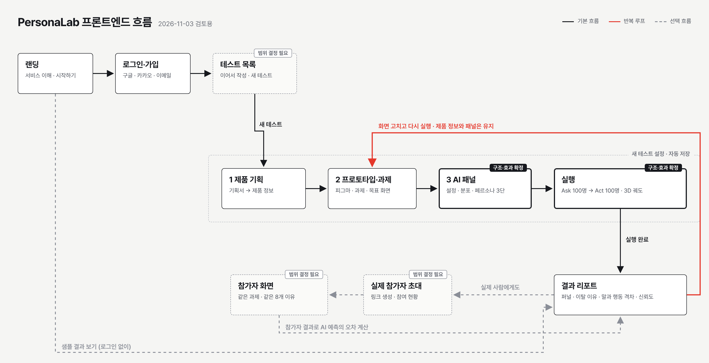

# PersonaLab 프론트엔드 워크플로우

작성일 2026-11-03 · 작성 승규(프론트엔드) · 상태: 검토용 초안

이 문서는 PersonaLab 웹 서비스에서 사용자가 처음 들어와 결과를 확인하고 다시 실행하기까지 거치는 화면 흐름을 정리한 것이다. 큰 흐름은 팀이 공유한 목업(https://personalab-mockup.vercel.app/)을 따르고, 화면별 역할과 데이터는 기획서와 개발 계획서(3장 사용자 흐름, 4장 화면 명세, 5장 리포트 설계, 10장 API)를 기준으로 맞췄다. 목업의 시험 메타포(수험표, 성적통지표 등)는 디자인 요소로 보고 이 문서에서는 쓰지 않는다. 디자인은 아직 확정되지 않았으며, 이 문서는 화면 순서와 각 화면이 해야 할 일만 정한다.

## 1. 한눈에 보는 흐름

사용자는 랜딩에서 서비스를 이해하고 로그인한 뒤 테스트 목록으로 들어온다. 새 테스트는 제품 기획, 프로토타입, AI 패널의 세 단계 설정을 거쳐 실행으로 넘어가고, 실행은 Ask(기획서를 읽고 답하기)와 Act(프로토타입을 직접 써보기)를 같은 100명에게 차례로 돌린다. 실행이 끝나면 결과 리포트에서 어디서 몇 명이 왜 그만뒀는지를 보고, 필요하면 실제 참가자 링크를 보내 같은 과제를 사람에게도 시켜 AI 예측의 오차를 잰다. 화면을 고친 뒤에는 프로토타입 단계로 돌아가 다시 실행한다. 이 "고치고 다시 실행" 루프가 서비스의 실질적인 사용 방식이다.

## 2. 화면별 흐름

### 2-1. 랜딩

처음 방문한 사람이 이 서비스가 무엇을 하는지 10초 안에 이해하게 하는 화면이다. 핵심 문장은 "묻지 않고, 써보게 합니다"이고, Ask(말)와 Act(행동)의 차이, 실제 사용자와의 대조로 오차를 보여준다는 세 가지를 순서대로 설명한다. 행동 유도 버튼은 "시작하기"와 "샘플 결과 보기" 두 개다. 샘플 결과는 로그인 없이 결과 리포트 예시로 바로 이어지게 해서, 가입 전에도 무엇을 얻는지 볼 수 있게 한다. 랜딩의 모든 숫자는 예시라는 문구를 화면 하단에 둔다.

### 2-2. 로그인과 가입

구글, 카카오 소셜 로그인과 이메일 로그인을 제공한다. 이메일은 가입과 비밀번호 재설정 링크를 함께 둔다. 로그인 실패 시에는 무엇이 틀렸는지와 어떻게 고칠지를 입력란 바로 아래에 보여준다. 로그인에 성공하면 이전에 보던 곳이 있으면 그곳으로, 없으면 테스트 목록으로 보낸다. 백엔드 인증이 붙기 전까지는 버튼을 누르면 데모 사용자로 들어가는 방식으로 둔다.

### 2-3. 테스트 목록

로그인 후 기본 화면이다. 지금까지 만든 테스트를 최근 순으로 보여주고, 각 테스트의 상태(설정 중, 실행 중, 결과 있음)와 마지막 결과 요약(완료율, 최다 이탈 화면)을 함께 표시한다. 테스트가 하나도 없을 때는 빈 화면 대신 "새 테스트 만들기"와 샘플 테스트 열기를 크게 보여준다. 설정 중인 테스트는 이어서 작성할 수 있어야 하고, 이를 위해 설정 단계의 입력은 자동 저장한다. 개발 계획서에서는 이 단위를 "스터디"라고 부르지만 화면에서는 사용자가 이해하기 쉬운 "테스트"로 부른다. 코드와 API에서는 계획서대로 study를 쓴다.

### 2-4. 새 테스트 1단계 · 제품 기획

Ask의 입력이 되는 화면이다. 기획서를 붙여넣거나 .txt, .md, .pdf 파일로 올리면 제품명, 설명, 기능 목록, 가격 정보로 정리해서 보여주고, 사용자가 직접 고칠 수 있다. 가격은 앵커링을 막기 위해 금액을 제시하지 않는 방식으로 다룬다(개발 계획서 7-3). 오른쪽에는 "AI 페르소나가 읽게 될 제품 소개"를 미리보기로 보여줘서, 사용자가 AI에게 무엇이 전달되는지 확인하게 한다. 제품명과 설명이 비어 있으면 다음 단계로 넘어가지 않는다.

### 2-5. 새 테스트 2단계 · 프로토타입과 과제

Act의 입력이 되는 화면이다. 피그마 공유 링크를 넣으면 화면과 버튼 연결을 읽어와 화면 목록으로 보여준다. 피그마 연동이 실패하거나 연결 정보가 없는 파일이면 화면 이미지를 올리고 버튼 연결을 직접 입력하는 수동 입력으로 전환한다(개발 계획서 3장 ③의 폴백). 같은 화면에서 과제 문장("회원가입을 완료하세요")과 목표 화면을 정하고, 첫 화면에서 목표 화면까지 이어지는 경로가 있는지 검사한다. 여기서 정한 과제와 이탈 이유 8개 카테고리는 AI와 실제 참가자에게 똑같이 쓰이므로, 문구를 바꿀 때 경고를 띄운다.

### 2-6. 새 테스트 3단계 · AI 패널 (구조 확정)

누구에게 써보게 할지를 분포로 고르는 화면이다. 팀 논의에서 3단 구조가 확정되었다. 왼쪽은 패널 설정으로 인원(20·50·100명), 소속, 연령, 가격 민감도, 개인정보 우려를 고르고 "패널 다시 뽑기"를 둔다. 가운데는 뽑힌 패널이 어떻게 분포되어 있는지 보여주는 시각화이고, 목표 분포와 실제로 뽑힌 분포를 비교해 특정 값으로 쏠리면 경고한다(개발 계획서 6-2의 생성 직후 분포 점검). 오른쪽은 페르소나 설명으로, 시각화에서 한 사람을 고르면 그 사람의 프로필과 전체 안에서의 위치를 보여준다. 그래프 형태(산점도, 평행 좌표, 점 쌓기 등)와 설명 방식은 아직 시안 비교 중이다. 화면 어디에서도 모델을 학습시킨다는 표현은 쓰지 않고 "공개 데이터의 분포를 반영한 페르소나 샘플링"으로 설명한다.

### 2-7. 실행 (궤도 효과 확정)

설정을 마치면 실행 화면으로 넘어간다. 먼저 100명이 기획서를 읽고 답하는 Ask가 진행되고, 이어서 같은 100명이 프로토타입을 조작하는 Act가 진행된다. Act 동안에는 페르소나들의 휴대폰 화면이 3D 궤도를 따라 돌면서 각자 지금 보고 있는 프로토타입 화면과 누르려는 버튼을 보여주는 효과가 확정되었다. 궤도에는 동시에 8대를 띄우고, 한 사람이 끝나거나 그만두면 다음 사람이 그 자리를 이어받는다. 궤도 옆에는 진행률(Ask 몇 명, Act 몇 명), 끝까지 간 사람과 그만둔 사람 수, 선택한 페르소나의 현재 상황, 실시간 기록을 둔다. 사용자는 일시정지와 배속 조절, 궤도를 끌어서 돌려보기를 할 수 있고, 실행이 끝나면 결과 보기 버튼이 활성화된다. 휴대폰이 보여주는 화면과 기록은 실제 실행 로그에서 나온 것이어야 하며, 체류 시간이나 망설임처럼 프로토타입에서 셀 수 없는 값은 표시하지 않는다(개발 계획서 5-2).

### 2-8. 결과 리포트

첫 화면은 3초 안에 읽혀야 한다는 원칙(개발 계획서 5-1)에 따라 네 가지만 먼저 보여준다. 화면별로 몇 명이 남았는지 보여주는 퍼널(AI와 실제 사용자를 겹쳐서), 가장 많이 그만둔 화면, 그만둔 이유 상위 세 가지, 그리고 "쓰겠다고 한 사람 대비 실제로 끝낸 사람"의 말과 행동 격차다. 실제 참가자 결과가 있으면 신뢰도 블록에서 "이 유형의 수치는 실측 대비 몇 %p 낙관적"이라는 오차를 함께 보여준다. 더 보고 싶은 사람은 퍼널의 화면이나 이유 막대를 눌러 그 조건에 해당하는 사람들로 좁혀 들어가고, 한 사람을 고르면 그 사람의 Ask 답변과 Act 경로를 나란히 보는 개별 추적으로, 다시 턴별 원본 기록으로 내려간다. AI가 쓴 문장에는 모두 AI 응답이라는 표시를 붙여 실제 참가자 응답과 섞이지 않게 한다. 하단에는 "화면 고치고 다시 실행"과 "실제 참가자 초대"를 둔다.

### 2-9. 실제 참가자 초대와 참가자 화면

같은 테스트에 실제 사람을 참가자로 추가하는 흐름이다. 테스트 작성자는 결과 리포트나 테스트 상세에서 참가 링크를 만들고 현재 몇 명이 참여했는지 본다. 링크를 받은 참가자는 로그인 없이 과제 안내, 프로토타입, 그만둘 때의 이유 선택(AI와 같은 8개 카테고리), 마지막 문항 순서로 진행한다. 참가자 화면의 안내 문구, 과제 문장, 이유 선택지는 AI에게 준 것과 글자 하나까지 같아야 비교가 성립한다. 개발 계획서는 이 화면을 P0로 두었지만 현재 목업에는 없으므로, 이번 시안 범위에 넣을지 아래 결정 사항에서 정한다.

### 2-10. 고치고 다시 실행

결과를 본 사용자가 "화면 고치고 다시 실행"을 누르면 2단계 프로토타입으로 돌아가고, 제품 정보와 AI 패널은 그대로 유지된다. 다시 실행하면 같은 패널이 새 프로토타입을 써보고, 결과 리포트에서는 이전 실행과 비교해 완료율과 최다 이탈 화면이 어떻게 바뀌었는지 보여준다. 실제 참가자는 다시 모으지 않고, 처음 측정한 오차를 이후 실행 결과에 붙여서 읽는다.

## 3. 화면 주소와 데이터 연결

화면 주소는 랜딩 `/`, 로그인 `/login`, 테스트 목록 `/tests`, 새 테스트 `/tests/new` 아래에 `product`, `prototype`, `panel` 단계, 실행 `/tests/:id/run`, 결과 `/tests/:id/report`, 참가자 화면 `/p/:token`으로 둔다. 지금은 모든 화면이 브라우저 안의 데모 데이터로 동작하고, 백엔드가 준비되는 대로 개발 계획서 10장의 API로 바꾼다. 테스트 생성은 `POST /studies`, 제품 정보는 `POST /studies/{id}/product`, 프로토타입은 `POST /studies/{id}/prototype`과 수동 입력용 `/prototype/manual`, 과제와 문항은 `/task`와 `/questions`, 패널 생성은 `/panel/generate`, 실행은 `POST /studies/{id}/runs`와 진행률 `GET /runs/{id}/status`, 결과는 `/report`, `/funnel`, `/gap`, `/calibration`, 참가자는 `/invites`, `/participate/{token}`에 대응한다. 데모 데이터도 이 API 응답과 같은 모양으로 만들어서, 연동할 때 화면 코드를 고치지 않고 데이터 출처만 바꾸게 한다.

모든 화면은 불러오는 중, 비어 있음, 오류 상태를 따로 설계한다. 불러오는 중에는 최종 화면 모양과 같은 뼈대를 보여주고, 비어 있으면 무엇을 하면 채워지는지 안내하며, 오류는 무엇이 잘못됐고 어떻게 고칠지를 해당 위치에 보여준다.

## 4. 진행 방식

디자인은 서로 다른 방향의 시안 세 개(정밀, 스튜디오, 리포트)로 랜딩부터 결과까지 전체 흐름을 만든 뒤 팀이 하나를 고르고, 고른 시안을 계속 다듬어 최종본을 만든다. 시안 세 개는 같은 데이터 엔진을 써서 숫자가 같고, 디자인 차이만 비교되게 한다. 작업은 `design/flow-variants` 브랜치에서 하고, 시안을 모아 고를 수 있는 허브 페이지를 함께 배포한다. `main` 브랜치와 기존 배포 주소는 최종본이 정해질 때까지 건드리지 않는다.

## 5. 결정이 필요한 것

첫째, 실제 참가자 초대와 참가자 화면(2-9)을 이번 시안 범위에 넣을지. 개발 계획서상 P0이고 8주차 체크포인트 항목이지만 목업에는 없다. 둘째, 테스트 목록(2-3)을 목업에 없는 화면으로 새로 넣을지, 로그인 후 바로 새 테스트 만들기로 보낼지. 셋째, AI 패널 가운데 그래프 형태와 오른쪽 설명 방식. 넷째, 시안 세 방향 중 무엇을 골라 계속 다듬을지.
